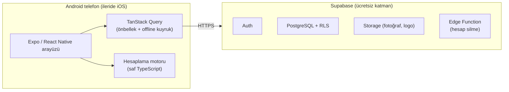
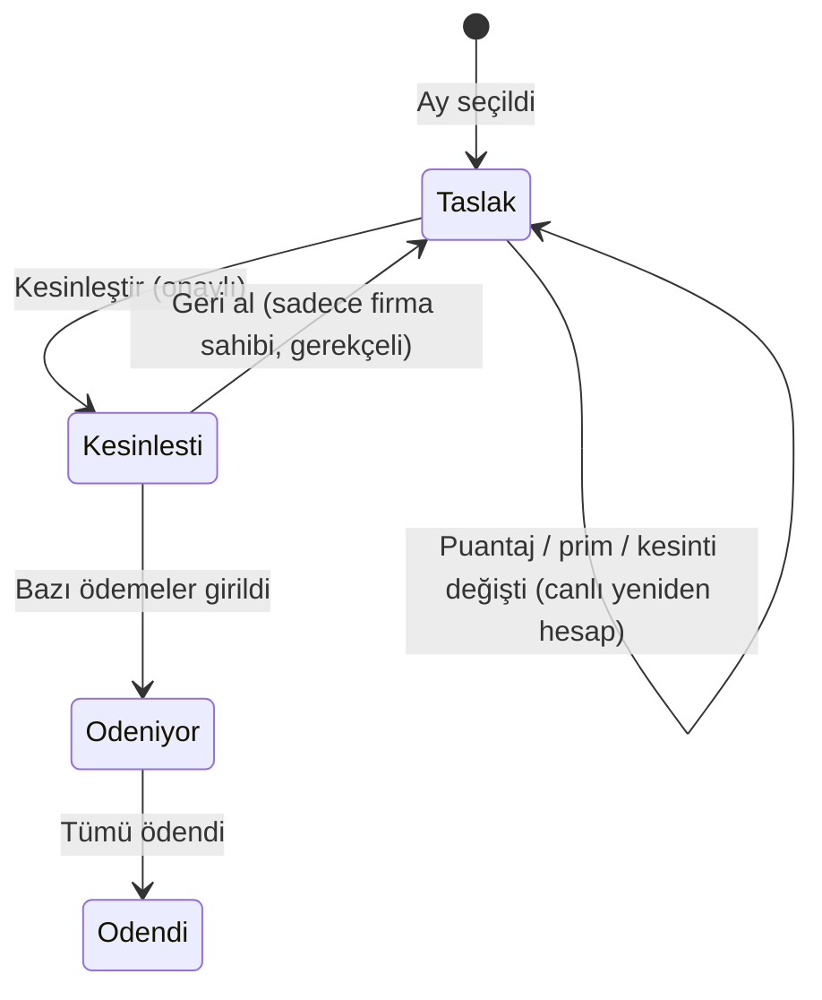
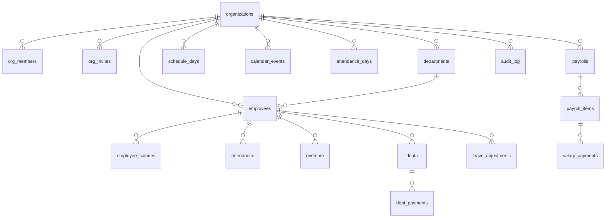
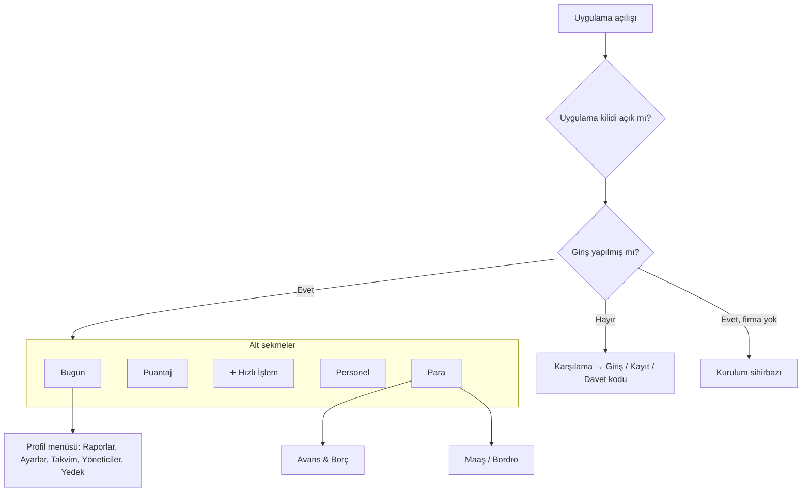
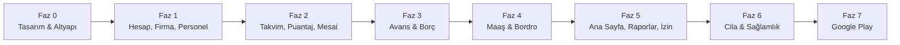

# Tekstil Personel Takip Uygulaması — Proje Planı (v2)

> Durum: **Planlama.** Bu doküman onaylanmadan kod yazılmayacak.
> Son güncelleme: 3 Ekim 2026

---

## 1. Amaç ve Kapsam

Tekstil atölyesi sahibinin/muhasebecisinin **telefondan**, çok az dokunuşla şunları yönetebilmesi:

| Modül | Ne yapar |
|---|---|
| **Personel** | Çalışan kartları, departman, işe giriş/çıkış, maaş geçmişi, iletişim |
| **Çalışma Takvimi** | Mesai başlangıç/bitiş saatleri, molalar, hafta sonu, resmî tatiller, özel günler (arife, firma tatili, hafta sonu ek çalışma) |
| **Puantaj** | Günlük yoklama: geldi / gelmedi / geç geldi / erken çıktı / izinli / raporlu… |
| **Mesai** | Hafta içi fazla çalışma, hafta sonu yarım gün çalışma, resmî tatil çalışması |
| **Avans & Borç** | Avans/borç verme, taksitlendirme, maaştan kesinti, elden tahsilat |
| **Maaş (net)** | Aylık net maaş hesaplama (devamsızlık kesintisi + mesai + prim − taksitler), kesinleştirme, ödeme takibi, maaş pusulası |
| **Yıllık İzin** | Kıdeme göre izin hakkı ve kalan izin |
| **Raporlar** | Puantaj cetveli, bordro özeti, borç dökümü, mesai raporu → PDF / Excel / WhatsApp |
| **Ana Sayfa** | Bugünün durumu, hatırlatmalar, özet rakamlar |

**Kapsam dışı (bilerek):** Brüt maaş, SGK primi, gelir/damga vergisi, e-bordro, SGK bildirgeleri. Bu işler muhasebecide kalır; biz **net** takip yaparız. Kıdem tazminatı tahmini, PDKS cihazı / QR ile giriş-çıkış ve çalışanların kullanacağı ayrı uygulama ileriki fazlarda ele alınabilir (Bölüm 13).

### Kararlaşan konular
- Maaş **aylık** ve **net** takip edilecek.
- Kesintiler **çalışma takvimine** göre hesaplanacak (saatlik/günlük ücret takvimden çıkarılır).
- Geç kalma **sadece kayıt** olarak tutulacak, maaştan kesilmeyecek.
- Hafta sonu normalde tamamen tatil; bazen **yarım gün ek çalışma** yapılıyor.
- Uygulamayı **yöneticiler** kullanacak (bir veya birkaç kişi).
- Öncelik **Android / Google Play** (hesabınız var). iOS aynı kodla ileride çıkarılabilecek.
- Supabase hesabı var.
- **Tasarım ve kullanıcı deneyimi en yüksek öncelik.**

---

## 2. Kullanıcı Profili ve Tasarım İlkeleri

Uygulamayı teknik bilgisi olmayan atölye sahipleri/şefleri, %90 telefondan, çoğunlukla ayakta ve hızlıca kullanacak. Bu yüzden:

1. **Tek elle kullanım.** Önemli butonlar ekranın alt yarısında; üst köşelere uzanma ihtiyacı en aza iner.
2. **Ekran başına tek ana iş.** Her ekranda belirgin tek bir ana buton olur.
3. **Az yazı, çok seçim.** Klavye sadece gerektiğinde açılır. Tutar ve saat girişinde özel sayı tuş takımı ve hazır seçenekler (`+15 dk`, `+30 dk`, `Yarım gün`) kullanılır.
4. **Varsayılan doğru olsun.** Yoklamada herkes "Geldi" başlar, sadece istisnalar işaretlenir. Avans formunda bugünün tarihi ve "tek seferde kes" seçili gelir.
5. **Geri alınabilirlik.** Küçük işlemlerden sonra "Geri al" bildirimi çıkar (onay penceresi yok). Silme ve bordro kesinleştirme gibi büyük işlemlerde açık bir onay ekranı gösterilir.
6. **Şeffaf hesap.** Her maaş rakamının yanında "Nasıl hesaplandı?" açıklaması olur. Kullanıcı rakama güvenmeli.
7. **Sade Türkçe.** "Kaydet", "Vazgeç", "Avans Ver" gibi ifadeler kullanılır. Teknik terim olmaz. Hata mesajı ne yapılacağını söyler ("İnternet yok, kayıt telefonda bekliyor, bağlanınca gönderilecek").
8. **Erişilebilirlik.** Dokunma alanları en az 48 dp, gövde yazısı en az 16 pt. Durumlar renk + ikon + yazı ile birlikte gösterilir (renk körlüğüne karşı). Telefondaki büyük yazı ayarıyla düzen bozulmaz.
9. **Şık ama sakin.** Bol boşluk, yumuşak köşeler, ölçülü renk, akıcı mikro animasyonlar ve dokunsal geri bildirim (titreşim). Gösterişli efekt yerine "pahalı hissettiren sadelik".

---

## 3. Teknoloji Mimarisi



### 3.1 Ana yığın

| Katman | Seçim | Gerekçe |
|---|---|---|
| Çerçeve | **Expo SDK 57**, React Native 0.86, TypeScript | Tek kodla Android, iOS ve web. Geliştirmede Expo Go ile anında test, yayında EAS Build. |
| Yönlendirme | **Expo Router** (`src/app/`) | Dosya tabanlı rotalar, `Stack.Protected` ile giriş koruması. |
| Sunucu verisi | **TanStack Query** + AsyncStorage persister | Önbellek, zayıf internette akıcılık, offline yazma kuyruğu. |
| Yerel arayüz durumu | Zustand | Tema, seçili departman gibi küçük tercihler. |
| Backend | **Supabase**: Postgres, Auth, RLS, Storage | Sunucu yazmaya gerek yok. Ücretsiz katman yeterli. Çok firmalı yapı RLS ile güvenli. |
| Formlar | react-hook-form + zod | Doğrulama ve Türkçe hata mesajları. |
| Tarih | date-fns + `tr` yereli | Türkçe gün/ay adları, hafta pazartesi başlar. |
| Hesaplama | `src/domain/` altında saf TS modülleri | Testlenebilir, arayüzden bağımsız, gerekirse sunucuya taşınabilir. |

### 3.2 Arayüz kütüphaneleri

Hepsi Faz 0'da SDK 57 ile uyum açısından tek tek doğrulanacak ve `npx expo install` ile kurulacak.

| İhtiyaç | Kütüphane |
|---|---|
| Animasyon | `react-native-reanimated`, `react-native-gesture-handler` |
| Alt sayfa (bottom sheet) | `@gorhom/bottom-sheet` |
| Uzun listeler (200+ kişi) | `@shopify/flash-list` |
| İkonlar | `lucide-react-native` + `react-native-svg` |
| Yazı tipi | `expo-font` + `@expo-google-fonts/plus-jakarta-sans` (Türkçe karakterleri tam destekler) |
| Dokunsal geri bildirim | `expo-haptics` |
| Görsel | `expo-image` |
| Grafik | `react-native-gifted-charts` (SVG tabanlı, hafif) |
| Saat seçici | `@react-native-community/datetimepicker` |
| PDF | `expo-print` + `expo-sharing` |
| Excel | SheetJS (`xlsx`, güncel sürüm SheetJS CDN'den) + `expo-file-system` (`File`, `Paths` API) |
| Bildirim | `expo-notifications` (yerel zamanlanmış, sunucu gerekmez) |
| Uygulama kilidi | `expo-local-authentication` (parmak izi / yüz) + PIN |
| Oturum saklama | `expo-secure-store` / AsyncStorage |
| Fotoğraf | `expo-image-picker` |
| Rehberden ekleme | `expo-contacts` (isteğe bağlı) |

> [!NOTE]
> Hazır bir UI kiti (Paper, Tamagui vb.) yerine **kendi tasarım sistemimizi** kuracağız (Bölüm 7). Böylece görünüm tamamen bize özgü ve şık olur, bağımlılık riski azalır.

### 3.3 Ortamlar
- **Supabase:** iki proje açılacak, `tekstil-dev` (geliştirme/test) ve `tekstil-prod` (gerçek veri). Ücretsiz katman 2 projeye izin veriyor.
- **EAS profilleri:** `development` (dev client), `preview` (APK, iç test), `production` (AAB, Play).
- **Veritabanı değişiklikleri:** `supabase/migrations/*.sql` dosyaları, `npx supabase db push` ile uzaktaki projeye uygulanır (Docker gerekmez). Tipler `supabase gen types` ile otomatik üretilir.

---

## 4. Maaş ve Kesinti Hesaplama Modeli

Uygulamanın kalbi bu bölüm, o yüzden en ayrıntılı kısım.

### 4.1 Çalışma takvimi (Ayarlar → Çalışma Saatleri)

Haftanın her günü için:

| Gün | İş günü mü | Başlangıç | Bitiş | Molalar |
|---|---|---|---|---|
| Pazartesi–Cuma | ✅ | 08:00 | 18:00 | Öğle 12:30–13:30 (**ücretsiz**), çay molaları (**ücretli**, düşülmez) |
| Cumartesi | ❌ (tatil) | — | — | — |
| Pazar | ❌ (tatil) | — | — | — |

→ Günlük çalışma süresi = bitiş − başlangıç − ücretsiz molalar = **9 saat**. Haftalık 45 saat.

Arayüzde hazır şablonlar olacak ("08:00–18:00, öğle 1 saat", "08:30–18:30" …). Tek dokunuşla seçilir, sonra istenirse değiştirilir. Haftalık toplam 45 saati aşarsa nazik bir uyarı çıkar (yasal sınır).

### 4.2 Özel günler (Ayarlar → Tatiller ve Özel Günler)

Takvim görünümünde yönetilir:

| Tür | Örnek | Hesaba etkisi |
|---|---|---|
| **Resmî tatil** | 29 Ekim, bayramlar | Otomatik yüklenir (2026–2030 tablosu uygulamada gömülü, düzenlenebilir). Maaş kesilmez. O gün çalışılırsa resmî tatil mesaisi ödenir. |
| **Yarım gün** | Arife (13:00'te biter) | O günün planlı süresi kısalır. Kesinti ve mesai buna göre hesaplanır. |
| **Firma tatili** | Bayram uzatması, sipariş yokluğu | Seçenek: *ücretli* (kesinti yok) veya *ücretsiz* (herkesten o günün süresi kadar kesilir). |
| **Ek çalışma günü** | "Cumartesi 08:00–13:00 yarım gün" | Tatil gününde planlı çalışma. Gelen kişiye mesai ücreti ödenir, gelmeyenden **kesinti yapılmaz** (ek çalışma zorunlu sayılmaz). Tüm personel veya seçili kişiler/departman için tanımlanabilir. |

### 4.3 Saatlik ücretin bulunması

Takvim girildikten sonra **saatlik ücret** iki yöntemle hesaplanabilir. Ayarlardan seçilir, örnekle açıklanır:

**Yöntem A — Takvimin yıllık ortalaması (önerilen, varsayılan)**
```
aylık ortalama saat = haftalık planlı saat × 52 / 12
saatlik ücret       = net maaş / aylık ortalama saat
günlük ücret        = saatlik ücret × o günün planlı saati
```
- Avantajı: takvime dayanır, **her ay aynı** ücret çıkar. Çalışan "bu ay 1 gün gelmedim, neden geçen aydan fazla kesildi?" diye sormaz.

**Yöntem B — O ayın gerçek planlı saati**
```
saatlik ücret = net maaş / (o aydaki iş günlerinin planlı saatleri toplamı)
```
- Takvime birebir uyar, ama iş günü az olan ayda (bayram ayı gibi) bir günlük devamsızlık daha pahalıya gelir.

**Örnek** (net maaş 30.000 ₺, Pzt–Cum 9 saat → haftalık 45 saat → aylık ortalama **195 saat**):

| Kalem | Hesap | Tutar |
|---|---|---|
| Saatlik ücret | 30.000 / 195 | **153,85 ₺** |
| Günlük ücret (9 saat) | 153,85 × 9 | **1.384,62 ₺** |
| 1 gün gelmedi | −9 saat | **−1.384,62 ₺** |
| 2 saat erken çıktı | −2 saat | **−307,69 ₺** |
| Geç geldi (40 dk) | sadece kayıt | **0 ₺** |
| Cumartesi 08:00–13:00 ek çalışma (5 saat, ×1,5) | 153,85 × 5 × 1,5 | **+1.153,85 ₺** |

> Ayarlar ekranında bu örnek **canlı** gösterilecek: kullanıcı mola süresini değiştirdiği anda "30.000 ₺ maaşlı biri 1 gün gelmezse 1.384,62 ₺ kesilir" cümlesi güncellenecek.

### 4.4 Puantaj durumları ve etkileri

| Durum | Renk / ikon | Kesinti | Not |
|---|---|---|---|
| **Geldi** (varsayılan) | yeşil ✓ | yok | Kayıt yoksa iş gününde "geldi" sayılır |
| **Gelmedi** (mazeretsiz) | kırmızı ✕ | o günün tüm planlı saati | |
| **Geç geldi** | amber ⏰ | **yok** | Geliş saati / gecikme dakikası kaydedilir, raporlarda görünür |
| **Erken çıktı / saatlik izin** | turuncu ↗ | çıkılan saatten mesai bitişine kadar *(ayar, bkz. Açık Sorular)* | |
| **Yarım gün** | turkuaz ◐ | planlı sürenin yarısı | |
| **Yıllık izin** (ücretli) | mor ☀ | yok | Yıllık izin bakiyesinden düşer |
| **Mazeret izni** (ücretli: evlilik, doğum, vefat) | mor ♥ | yok | Bakiyeden düşmez |
| **Ücretsiz izin** | gri ⏸ | o günün tüm planlı saati | |
| **Raporlu** | mavi ✚ | ayara bağlı | Varsayılan: kesilir (raporu SGK öder). "İlk 2 günü işveren öder" seçeneği var. |

Tatil günlerinde (hafta sonu, resmî tatil) yoklama girilmez. Ek çalışma günü tanımlıysa o gün sadece ek çalışmaya çağrılanlar listelenir.

### 4.5 Mesai (fazla çalışma)

| Tür | Varsayılan çarpan | Nasıl girilir |
|---|---|---|
| Hafta içi fazla çalışma | ×1,5 | Puantajda kişiye dokun → "Mesai ekle" → `+1 sa`, `+2 sa`, `+3 sa` veya bitiş saati |
| Hafta sonu ek çalışma | ×1,5 | Ek çalışma günü tanımlayınca gelenlere otomatik yazılır |
| Resmî tatil çalışması | ×2,0 | Resmî tatilde ek çalışma günü tanımlanınca otomatik yazılır |

Çarpanların hepsi ayarlardan değiştirilebilir. Yıllık 270 saat yasal mesai sınırına yaklaşan çalışan için bilgi notu gösterilir.

### 4.6 Aylık net maaş formülü

```
Hak edilen maaş   = net maaş            (ay ortasında giriş/çıkış veya zam varsa takvim gününe göre kıst)
− Devamsızlık     = Σ (kaçırılan planlı saat × saatlik ücret)
+ Mesai           = Σ (mesai saati × saatlik ücret × çarpan)
+ Prim / ikramiye  (elle)
− Ek kesinti       (elle, açıklamalı)
= Ara toplam
− Avans/borç taksitleri  (önerilen; değiştirilebilir, "bu ay atla" seçeneği)
= ÖDENECEK NET
```

**Kurallar ve sınır durumları:**
- **Kıst hesap:** Ay içinde işe giren/çıkan çalışanda `net maaş / 30 × çalıştığı takvim günü`. Devamsızlık sadece çalıştığı dönemdeki günler için hesaplanır.
- **Ay ortası zam:** Maaş geçmişi tarih bazlı tutulur (`employee_salaries`). Zam yapılan ay, günlere göre iki parçalı hesaplanır.
- **Taksit önerisi:** Her açık borç için `taksit tutarı = tutar / taksit sayısı`, kalan borcu aşmaz. "Tek seferde" seçilmişse kalan borcun tamamı önerilir. Önce eski borçlar kapanır.
- **Negatif net:** Taksitler otomatik azaltılır ve uyarı verilir. Kesintiler maaşı yine de aşıyorsa "Fark borç olarak kaydedilsin mi?" seçeneği sunulur.
- **Yuvarlama:** Her kalem kuruşa yuvarlanır (yarım yukarı). Tutarlar veritabanında `numeric(12,2)` olarak saklanır, kayan nokta hatası olmaz.
- **Hafta tatili kesintisi (isteğe bağlı, varsayılan kapalı):** Hafta içi mazeretsiz devamsızlık varsa o haftanın tatil ücreti de kesilebilir.

### 4.7 Bordro yaşam döngüsü


- **Taslak:** Rakamlar canlı hesaplanır. Prim, ek kesinti, taksit değişiklikleri kaydedilir, kaybolmaz.
- **Kesinleştir:** Tek bir veritabanı işlemiyle (atomik `finalize_payroll()` fonksiyonu) tüm satırların anlık görüntüsü dondurulur ve taksitler borçlardan düşülür.
- Kesinleşmiş aya ait puantaj **kilitlenir**. Değiştirmek için bordro geri alınır; geri alınca borç düşümleri de geri döner.
- **Ödeme takibi:** Her çalışan için "Ödendi" (nakit / banka) işaretlenir. Kısmi ödeme yapılabilir, kalan görünür. "Hepsini ödendi işaretle" kısayolu var.

### 4.8 Yıllık izin hakkı
- Kıdeme göre otomatik hesaplanır (İş Kanunu md. 53): 1–5 yıl **14 gün**, 5–15 yıl **20 gün**, 15 yıl ve üzeri **26 gün**. 18 yaşından küçük ve 50 yaşından büyüklere en az 20 gün (bunun için doğum tarihi gerekir).
- Uygulamayı kullanmaya başlamadan önceki izinler için "devreden / kullanılmış izin" elle girilebilir.
- Çalışan kartında "Kalan izin: 9 gün" olarak görünür.

---

## 5. Veri Modeli

Tüm tablolarda `org_id` bulunur. **RLS** kuralı: kullanıcı yalnızca üyesi olduğu firmanın satırlarını görür ve değiştirir. Silme yerine çoğunlukla **pasife alma** uygulanır (geçmiş korunur).



| Tablo | Önemli alanlar | Not |
|---|---|---|
| `organizations` | name, logo_url, settings (jsonb: hesap yöntemi, çarpanlar, rapor kuralı…) | |
| `org_members` | user_id, role (`owner`/`admin`) | |
| `org_invites` | code (6 hane), role, expires_at | E-posta sunucusu gerektirmeyen davet kodu |
| `departments` | name, color, sort_order | Kesim, Dikim, Ütü-Paket, Kalite… |
| `schedule_days` | weekday (1–7), is_workday, start_time, end_time, breaks (jsonb: start, end, paid), department_id (null = genel) | İleride departmana özel vardiya desteği |
| `calendar_events` | date, type (`resmi_tatil`/`yarim_gun`/`firma_tatili`/`ek_calisma`), start/end_time, paid, multiplier, title, scope (tümü/departman/kişiler) | |
| `employees` | full_name, department_id, phone, tc_no, iban, birth_date, address, photo_url, start_date, end_date, active, notes, emergency_contact | |
| `employee_salaries` | amount (net aylık), effective_from, note | Maaş geçmişi ve zamlar |
| `attendance` | employee_id, day, status, arrival_time, leave_time, late_minutes, missed_minutes, note | **unique(employee_id, day)**; sadece istisnalar yazılır |
| `attendance_days` | day, confirmed_by, confirmed_at | "Bugünün yoklaması tamamlandı" bilgisi |
| `overtime` | employee_id, day, hours, kind, multiplier, calendar_event_id, client_ref (uuid, benzersiz) | Tekrar gönderimde çift kayıt oluşmaz |
| `debts` | employee_id, type (`avans`/`borc`/`diger`), amount, given_at, installments, start_month, description, client_ref (uuid, benzersiz) | Kalan tutar ödemelerden hesaplanır |
| `debt_payments` | debt_id, amount, paid_at, method (`maas_kesinti`/`elden`), payroll_item_id | |
| `leave_adjustments` | employee_id, days (+/−), reason, date | Devreden/elle düzeltme |
| `payrolls` | year, month, status, finalized_at/by, totals | unique(org_id, year, month) |
| `payroll_items` | anlık görüntü: salary, hourly_rate, base, absence_cut, overtime_pay, bonus, extra_cut(+note), debt_cut, net, breakdown (jsonb) + ayarlamalar (skip_debt, debt_override) | |
| `salary_payments` | payroll_item_id, amount, paid_at, method (`nakit`/`banka`) | |
| `audit_log` | user_id, table, row_id, action, diff, at | Tetikleyici ile otomatik: "kim, neyi, ne zaman değiştirdi" |

**Veritabanı fonksiyonları (RPC):**
- `create_organization(name)`: firma, sahip üyeliği, varsayılan takvim ve resmî tatiller tek işlemde oluşur.
- `join_organization(code)`: davet koduyla yönetici olarak katılma.
- `finalize_payroll(payroll_id, items)` / `revert_payroll(payroll_id, reason)`: atomik çalışır.
- `upsert_attendance_bulk(day, rows)`: toplu yoklama.

**İndeksler:** `(org_id, day)`, `(employee_id, day)`, `(org_id, active)`, `(debt_id)`. 200+ çalışan × yıllarca veride bile ay bazlı sorgular hızlı kalır. Sadece istisnalar kaydedildiği için veri hacmi küçük olur (200 kişilik firmada yılda tahminen 10–15 bin satır).

**Tarih kuralı:** `day` gibi tarih alanları uygulamanın her katmanında **ISO tarih dizgisi** (`2026-10-03`) olarak taşınır; JS `Date` nesnesine çevrilip geri çevrilmez (saat dilimi kaynaklı bir gün kayma hatasını baştan önler).

---

## 6. Ekranlar ve Kullanıcı Akışları

### 6.1 Gezinme yapısı



- **Alt sekme çubuğu:** 4 sekme + ortada belirgin yuvarlak **➕** butonu. Butona basınca alt sayfa açılır: *Avans Ver · Mesai Ekle · İzin/Rapor Gir · Çalışan Ekle · Ek Çalışma Günü Planla*. En sık işler her ekrandan 2 dokunuşla yapılabilir.
- Raporlar ve Ayarlar, "Bugün" ekranının sağ üstündeki profil/firma avatarından açılır (az kullanılan işler ana menüyü kalabalıklaştırmaz).

### 6.2 Karşılama ve Kurulum Sihirbazı (ilk açılış)
1. **Karşılama:** Logo, tek cümlelik değer önerisi ("Personel, puantaj ve maaş artık cebinizde"), "Başlayalım" butonu, altta "Hesabım var".
2. **Kayıt:** Ad, e-posta, şifre (göster/gizle). İleride Google ile giriş eklenebilir.
3. **Firma adı** (+ isteğe bağlı logo).
4. **Çalışma saatleri:** Hazır şablon kartlarından biri seçilir, düzenlenebilir. Canlı özet gösterilir: "Haftada 45 saat, günde 9 saat".
5. **Departmanlar:** Hazır öneriler çip olarak gelir (Kesim, Dikim, Ütü, Paket, Kalite). Dokununca seçilir.
6. **İlk çalışanlar:** Elle hızlı ekleme (ad + maaş), rehberden seçme veya Excel şablonundan içe aktarma. "Sonra eklerim" ile atlanabilir.
7. **Bitti:** Kısa kutlama animasyonu, ardından "Bugün" ekranı. Üstte 3 adımlık "ilk kullanım" kartı (ilk yoklamayı gir, ilk avansı ver…) görünür, tamamlandıkça kaybolur.

Her adımda ilerleme göstergesi, geri dönme imkânı ve "Atla" seçeneği olur.

### 6.3 Bugün (Ana Sayfa)
```
┌─────────────────────────────────┐
│ Günaydın, Muhammed        (◉)   │  ← firma avatarı → menü
│ 3 Ekim Cumartesi · Hafta sonu   │
├─────────────────────────────────┤
│ ┌─ Bugünün Yoklaması ─────────┐ │
│ │  Henüz girilmedi            │ │  ← girildiyse: 42/47 işte ✓
│ │  [  Yoklamayı Başlat  →  ]  │ │
│ └─────────────────────────────┘ │
│ ┌────────────┐ ┌────────────┐   │
│ │ İşte       │ │ Açık avans │   │
│ │ 42 / 47    │ │ ₺18.500    │   │
│ └────────────┘ └────────────┘   │
│ ┌────────────┐ ┌────────────┐   │
│ │ Bu ay devam│ │ Tahmini    │   │
│ │ sızlık 6 gn│ │ maaş ₺1,2M │   │
│ └────────────┘ └────────────┘   │
│ Yaklaşanlar                     │
│ • Pazartesi: 29 Ekim tatil      │
│ • Cumartesi ek çalışma (12 kişi)│
│ • Maaş günü: 5 Kasım            │
│ Son 30 gün devam oranı  ▁▃▅▇▆█  │
└─────────────────────────────────┘
```
- Kartlara dokunulunca ilgili ekran filtrelenmiş olarak açılır (ör. "Açık avans" → borçlu çalışanlar listesi).
- Veriler yüklenirken iskelet (skeleton) gösterilir, boş ekran görünmez.

### 6.4 Puantaj ⭐ (en sık kullanılacak ekran)
```
┌─────────────────────────────────┐
│  ‹   Pazartesi, 5 Ekim   ›  Bugün│
│  İş günü · 08:00–18:00          │
│  ● 44 Geldi  ● 2 Gelmedi  ● 1 İzin│
│  [Ara…]  (Tümü)(Kesim)(Dikim)…  │
├─────────────────────────────────┤
│ (AY) Ayşe Yılmaz      [✓ Geldi] │
│      Dikim                       │
│ (MK) Mehmet Kaya    [✕ Gelmedi] │
│ (FD) Fatma Demir  [⏰ 08:40 Geç]│
│  …                               │
├─────────────────────────────────┤
│   [  ✓ Yoklamayı Tamamla  ]     │  ← sabit alt buton
└─────────────────────────────────┘
```
- **Kişiye dokun →** alt sayfada büyük renkli kutular açılır: Geldi · Gelmedi · Geç Geldi · Erken Çıktı · İzinli · Raporlu · Diğer (yarım gün, ücretsiz izin, mazeret izni). Seçim anında kaydedilir, hafif titreşim olur, satırdaki etiket animasyonla değişir.
- **Geç geldi:** Hızlı çipler (`+10 dk`, `+15 dk`, `+30 dk`, `+1 sa`) veya saat seçici. Varsayılan değer mesai başlangıcı + 15 dk.
- **Erken çıktı:** Çıkış saati seçilir, kesinti tutarı anında gösterilir ("−307,69 ₺").
- **Mesai ekle** aynı alt sayfadan yapılır: `+1 sa`, `+2 sa`, `+3 sa`.
- **Toplu işlem:** Bir kişiye uzun basınca çoklu seçim açılır ("Seçilenleri: İzinli yap").
- **Yoklamayı Tamamla:** Gün onaylanır ve ana sayfadaki hatırlatma kalkar. Tamamlanmasa da tüm kayıtlar zaten anında kaydedilmiştir.
- Tatil gününde liste yerine sakin bir görsel görünür ("Bugün hafta sonu 🌿") ve "Ek çalışma günü planla" butonu çıkar.
- Kesinleşmiş aylarda kilit ikonu ve açıklama gösterilir.
- 200+ kişide FlashList ile akıcı kaydırma, departmana göre gruplanmış başlıklar ve hızlı arama.
- Takvim görünümüne geçiş: aylık ızgarada her gün o günün devamsızlık sayısıyla renklenir.

### 6.5 Personel
- **Liste:** Arama, departman çipleri, "Aktif / Ayrılanlar" filtresi. Her satırda baş harfli renkli avatar (veya fotoğraf), ad, departman ve varsa borç rozeti.
- **Çalışan detayı:**
  - Üst kart: fotoğraf, ad, departman, kıdem ("2 yıl 4 ay"), **Ara** ve **WhatsApp** butonları.
  - Özet şeridi: *Bu ay 1 gün devamsız · ₺2.000 açık borç · 9 gün izin hakkı*.
  - Sekmeler: **Puantaj** (aylık takvim ısı haritası + liste) · **Para** (borçlar, ödemeler, maaş geçmişi, pusulalar) · **Bilgiler** (kişisel bilgiler, IBAN kopyala, maaş geçmişi/zam ekle).
  - Alt menü: Avans Ver, İzin Gir, Düzenle, İşten Çıkışını Yap.
- **Ekle/Düzenle formu:** Zorunlu alanlar sadece *Ad Soyad, Net Maaş, İşe Giriş Tarihi*. Diğerleri katlanabilir "Ek bilgiler" bölümünde. TC Kimlik No ve IBAN için format doğrulaması yapılır.
- **İşten çıkış:** Çıkış tarihi seçilir. Uygulama o ayın kıst maaşını ve kalan borcunu özetler ("Kalan borç 1.500 ₺ son maaştan kesilsin mi?").

### 6.6 Para → Avans & Borç
- Üstte toplam açık borç kartı. Altta borçlu çalışanların listesi (kalan tutar, ilerleme çubuğu, sıradaki taksit).
- **Avans Ver akışı** (tek alt sayfa, 4 alan): çalışan seç (son seçilenler üstte) → tutar (büyük sayı tuş takımı, canlı ₺ biçimi) → kesinti şekli çipleri: *Tek seferde · 2 · 3 · 4 · 6 ay · Özel* → açıklama (isteğe bağlı) → **Kaydet**. Taksit seçilince "Kasım–Ocak arası aylık 1.000 ₺ kesilecek" önizlemesi gösterilir.
- **Borç detayı:** Ödeme zaman çizelgesi (maaştan kesintiler + elden ödemeler), "Elden ödeme al", "Taksiti değiştir", "Borcu sil" (onaylı; ödeme varsa silinemez, sadece kapatılır).

### 6.7 Para → Maaş / Bordro
- **Ay seçici** ve durum rozeti (Taslak / Kesinleşti / Ödendi).
- **Özet kartı:** Toplam ödenecek, toplam kesinti, toplam mesai, borç tahsilatı.
- **Çalışan listesi:** Ad ve net tutar. Altında küçük rozetler: `−1 gün`, `+5 sa mesai`, `−1.000 taksit`. Uyarı varsa (negatif net, eksik maaş bilgisi) satır vurgulanır.
- **Satıra dokun → hesap detayı:** Bölüm 4.6'daki formül satır satır, sade dille gösterilir ("1 gün gelmedi (12 Ekim): −1.384,62 ₺"). Düzenlenebilir alanlar: Prim, Ek kesinti (+ açıklama), Taksiti bu ay atla / tutarı değiştir.
- **Kesinleştir:** Özet ekranı gösterilir, kullanıcı "Kontrol ettim, kesinleştir" düğmesine basılı tutarak onaylar (yanlışlıkla dokunmayı önler).
- **Kesinleşme sonrası:** Her satırda "Ödendi" anahtarı. "Maaş Pusulası" çalışanın WhatsApp'ına paylaşılacak PDF olarak hazırlanır. "Toplu Bordro PDF / Excel" alınabilir.

### 6.8 Raporlar
| Rapor | İçerik | Biçim |
|---|---|---|
| **Aylık puantaj cetveli** | Satır: çalışan, sütun: günler, hücrede durum sembolü (klasik tekstil puantaj çizelgesi), en sağda toplamlar | Excel, PDF (yatay) |
| **Bordro özeti** | Tüm kalemler ve toplamlar | Excel, PDF |
| **Maaş pusulası** | Tek çalışan, firma logolu, şık tasarım | PDF |
| **Avans/borç dökümü** | Çalışan bazında verilen, ödenen, kalan | Excel, PDF |
| **Mesai raporu** | Kişi/ay bazında saat ve tutar | Excel |
| **Devamsızlık analizi** | En çok devamsızlık yapanlar, gün dağılımı, geç kalma sıklığı | Ekranda grafik + PDF |
| **Yıllık izin durumu** | Hak, kullanılan, kalan | Excel |
| **Personel listesi** | İletişim, departman, giriş tarihi | Excel |
| **Tüm veri yedeği** | Bütün tablolar, sayfa sayfa | Excel + JSON (geri yüklenebilir) |

Raporlar tarih aralığı ve departmana göre filtrelenir. Paylaşım telefonun kendi paylaşım menüsüyle yapılır (WhatsApp, e-posta, Drive).

### 6.9 Ayarlar
- **Firma:** ad, logo.
- **Çalışma saatleri** (Bölüm 4.1) ve **Tatiller & özel günler** (takvim, Bölüm 4.2).
- **Hesaplama kuralları:** saatlik ücret yöntemi (A/B), mesai çarpanları, rapor kuralı, erken çıkış kesintisi, hafta tatili kesintisi. Her seçeneğin altında sade açıklama ve canlı örnek bulunur.
- **Departmanlar** (renk seçimi ve sıralama).
- **Yöneticiler:** davet kodu oluştur, yöneticileri listele/çıkar.
- **Güvenlik:** uygulama kilidi (parmak izi / yüz / PIN), arka planda otomatik kilit süresi.
- **Bildirimler:** günlük yoklama hatırlatması (saati seçilir), maaş günü hatırlatması.
- **Görünüm:** Açık / Koyu / Sistem; yazı boyutu önizlemesi.
- **Yedek & dışa aktar.**
- **Hesap:** çıkış yap, **hesabı ve verileri sil** (Google Play zorunluluğu).

### 6.10 Durum ekranları
- **Boş durumlar:** Sade bir illüstrasyon, tek cümle ve tek buton ("Henüz çalışan yok · Çalışan Ekle").
- **İnternet yok:** Üstte ince bir şerit ("Çevrimdışı · 3 kayıt gönderilmeyi bekliyor"). Yazma işlemleri kuyruğa alınır.
- **Hata:** Ne olduğunu ve ne yapılacağını söyleyen mesaj + "Tekrar dene".

---

## 7. Tasarım Sistemi

> [!IMPORTANT]
> Faz 0'da bu sisteme göre **ana ekranların görsel taslakları (mockup)** hazırlanıp onayınıza sunulacak. Renk ve yazı tipi seçimi taslaklar üzerinden kesinleşecek.

### 7.1 Renkler (öneri: "Lacivert & Mercan" — güven veren, kurumsal ama sıcak)

| Rol | Açık tema | Koyu tema | Kullanım |
|---|---|---|---|
| Primary | `#3B5BDB` (çivit mavisi) | `#748FFC` | Ana butonlar, seçili sekme |
| Accent | `#FF7A59` (mercan) | `#FF9E85` | ➕ butonu, vurgular |
| Background | `#F6F7FB` | `#0E1116` | Ekran zemini |
| Surface | `#FFFFFF` | `#171B22` | Kartlar |
| Text | `#101828` | `#F2F4F7` | Ana metin |
| Muted | `#667085` | `#98A2B3` | Yardımcı metin |
| Border | `#E4E7EC` | `#2A303A` | Ayırıcılar |

**Durum renkleri** (tüm uygulamada tutarlı):
Geldi `#12B76A` · Gelmedi `#F04438` · Geç `#F79009` · Erken çıktı `#EF6820` · Yarım gün `#15B79E` · İzin `#7A5AF8` · Rapor `#2E90FA` · Ücretsiz izin `#667085`. Etiketlerde açık ton zemin + koyu ton yazı kullanılır (yüksek kontrast, WCAG AA).

### 7.2 Tipografi
- Yazı tipi: **Plus Jakarta Sans** (modern, okunaklı, Türkçe karakterler tam).
- Ölçek: Display 32/700 · Başlık 22/700 · Alt başlık 18/600 · Gövde 16–17/500 · Küçük 14/500 · Etiket 12/600.
- Para ve saatlerde **eşit genişlikli rakamlar** (tabular numbers), böylece sütunlar hizalı durur.
- Para biçimi: `₺30.000,00`. Büyük özetlerde `₺1,2 Mn`.

### 7.3 Şekil, boşluk ve derinlik
- 4 pt ızgara. Ekran kenar boşluğu 20. Kart iç boşluğu 16–20.
- Köşe yarıçapı: küçük 10 · kart 16 · alt sayfa 28 · buton 14 (tam yuvarlak hap butonlar da kullanılabilir).
- Gölgeler çok yumuşak ve az (1–2 seviye). Koyu temada gölge yerine ince kenar çizgisi.

### 7.4 Hareket ve geri bildirim
- Geçişler 200–280 ms, yay (spring) eğrileri.
- Durum değişince etiket rengi yumuşakça geçer. Liste öğeleri eklenip çıkarken düzen animasyonu oynar.
- Titreşim: seçimde hafif, başarıda "başarı" deseni, hatada "uyarı" deseni.
- Telefonda "hareketi azalt" ayarı açıksa animasyonlar sadeleşir.

### 7.5 Bileşen kütüphanesi (`src/ui/`)
`Screen`, `Header`, `Button` (primary / secondary / ghost / danger, basılı tutarak onaylama varyantı), `IconButton`, `Card`, `StatCard`, `ListRow`, `Avatar`, `StatusPill`, `Chip` / `ChipGroup`, `SegmentedControl`, `TextField`, `MoneyField`, `NumberPad`, `TimeField`, `DateStepper`, `CalendarSheet`, `BottomSheet`, `ActionSheet`, `Toast` / Geri al bildirimi, `ConfirmSheet`, `EmptyState`, `Skeleton`, `ProgressBar`, `Badge`, `SectionHeader`, `OfflineBanner`.
Her bileşen tema token'larıyla çalışır, açık ve koyu temayı otomatik destekler.

### 7.6 İkon ve marka
- Lucide ikon seti (ince, tutarlı çizgi).
- Uygulama ikonu ve açılış ekranı: makara/iplik + onay işareti motifli sade bir logo (taslak Faz 0'da).
- Uygulama adı önerileri: **Atölye Defteri**, **Ustabaşı**, **Puantajım**, **TekstilPro** (karar sizin).

---

## 8. Güvenlik, Gizlilik ve Güvenilirlik

| Konu | Önlem |
|---|---|
| Firma verisi ayrımı | Her tabloda RLS. İki test firmasıyla otomatik "birbirini göremez" testi yapılır. |
| Anahtarlar | Uygulamada sadece `anon` (herkese açık) anahtar bulunur. `service_role` anahtarı sadece Edge Function'da tutulur. |
| Oturum | Telefonun güvenli deposunda saklanır, otomatik yenilenir. |
| Uygulama kilidi | Parmak izi / yüz tanıma / PIN. Maaş verisi meraklı gözlerden korunur. |
| Hassas alanlar | TC kimlik no ve IBAN listelerde maskeli görünür (`*** ** 1234`), detayda açılır. |
| Değişiklik geçmişi | `audit_log` tutulur. Maaş, borç ve puantaj değişikliklerinde "kim, ne zaman" bilgisi kalır. |
| Eşzamanlı düzenleme | İki yönetici aynı kaydı değiştirirse **son yazan kazanır**; önceki değer audit_log'dan görülebilir. Yönetici sayısı az olduğundan bu strateji yeterlidir. |
| KVKK | Gizlilik politikası ve aydınlatma metni hazırlanır. Veri yalnızca ilgili firmanın erişimindedir. Hesap silindiğinde tüm veri silinir. |
| Yedek | Supabase ücretsiz katmanda otomatik yedek yok. Bunun için uygulama içinde tek dokunuşla "Excel yedeği" ve haftalık yedek hatırlatması olacak. Ayrıca **tüm tabloları ilişkileri ve jsonb alanlarıyla koruyan JSON yedeği** alınabilir ve uygulamadan **geri yüklenebilir** (Excel insan okuması içindir; geri yükleme için kayıplıdır). |
| Hesap silme | Uygulama içinde ve web adresinden (Play şartı). Edge Function ile auth kullanıcısı ve firma verisi silinir. |

---

## 9. Çevrimdışı Çalışma ve Performans

- **Okuma:** Son çekilen veriler telefonda saklanır. İnternet yokken de listeler, puantaj ve borçlar görünür.
- **Yazma:** Puantaj, mesai ve avans kayıtları internet yoksa kuyruğa alınır, bağlantı gelince sırayla gönderilir. Kuyruktaki **her kayıt telefonda üretilmiş bir UUID (idempotency anahtarı) taşır**; istek sunucuya ulaşıp cevabı telefona dönmediğinde yeniden deneme aynı kaydı ikinci kez yazamaz. Puantajda ayrıca `(çalışan, gün)` benzersizliği, `debts` ve `overtime` tablolarında bu UUID'ye benzersiz kısıtlama vardır.
- **Çevrimiçi zorunlu işlemler:** Bordro kesinleştirme, yönetici davet etme, hesap silme.
- **Performans hedefleri:** Soğuk açılış < 2 sn (orta seviye Android). 200 kişilik puantaj listesinde 60 fps kaydırma. Durum değişikliği ekranda < 100 ms (iyimser güncelleme).
- **Test cihazları:** Düşük seviye Android (2–3 GB RAM, 5,5" ekran), güncel orta seviye Android, büyük yazı ayarı açık cihaz.

---

## 10. Maliyet

| Kalem | Maliyet |
|---|---|
| Expo, Expo Go, EAS Build (ücretsiz katman, aylık sınırlı build) | 0 ₺ |
| EAS Update (OTA güncelleme, ücretsiz katman) | 0 ₺ |
| Supabase Free (500 MB DB, 1 GB dosya, 50.000 aktif kullanıcı) | 0 ₺ |
| Google Play hesabı | Mevcut |
| Gizlilik politikası barındırma (GitHub Pages) | 0 ₺ |
| Kayıt/şifre sıfırlama e-postaları (Supabase'in kendi SMTP'si saatte birkaç e-posta ile sınırlı; yayında Resend ücretsiz katmanı: ayda 3.000 e-posta) | 0 ₺ |
| *İleride* Apple Developer | yılda 99 $ |
| *İleride, büyürse* Supabase Pro (günlük yedek, duraklatma yok) | ayda 25 $ |

> [!WARNING]
> Supabase ücretsiz projeleri **7 gün hiç istek almazsa duraklatılır** (veri silinmez, panelden açılır). Günlük kullanımda sorun olmaz. Uygulama mağazada başka firmalara açıldığında, kullanıcı sayısı arttıkça Pro plana geçmek değerlendirilmeli.

---

## 11. Proje Yapısı

```
tekstil/
├── src/
│   ├── app/                         # Expo Router — SADECE ekranlar
│   │   ├── _layout.tsx              # Sağlayıcılar, tema, font, auth koruması
│   │   ├── (auth)/                  # hosgeldin, giris, kayit, sifre-sifirla, davet
│   │   ├── kurulum/                 # sihirbaz adımları
│   │   ├── (tabs)/
│   │   │   ├── _layout.tsx          # Özel sekme çubuğu + ➕
│   │   │   ├── index.tsx            # Bugün
│   │   │   ├── puantaj.tsx
│   │   │   ├── personel.tsx
│   │   │   └── para.tsx             # Avans&Borç | Maaş
│   │   ├── personel/[id].tsx, personel/duzenle.tsx
│   │   ├── borc/[id].tsx, avans-ver.tsx (formSheet)
│   │   ├── bordro/[yil]/[ay].tsx, bordro/kalem/[id].tsx
│   │   ├── raporlar/…
│   │   └── ayarlar/…                # firma, calisma-saatleri, takvim, kurallar, departmanlar, yoneticiler, guvenlik, bildirimler, gorunum, hesap
│   ├── domain/                      # SAF iş mantığı (test edilir)
│   │   ├── schedule.ts              # güne göre planlı dakika (takvim + özel günler)
│   │   ├── wage.ts                  # saatlik/günlük ücret (yöntem A/B, kıst, zam)
│   │   ├── attendance.ts            # durum → kaçırılan dakika
│   │   ├── overtime.ts
│   │   ├── debts.ts                 # kalan, taksit önerisi, dağıtım
│   │   ├── payroll.ts               # tüm kalemleri birleştirir
│   │   ├── leave.ts                 # yıllık izin hakkı
│   │   └── holidays-tr.ts           # 2026–2030 resmî tatiller
│   ├── data/                        # Supabase istemcisi, sorgu/mutasyon hook'ları, offline kuyruk
│   ├── ui/                          # Tasarım sistemi bileşenleri
│   ├── features/                    # Ekranlara özel bileşenler (puantaj satırı, bordro kartı…)
│   ├── export/                      # PDF şablonları (HTML), Excel üreticileri
│   ├── theme/                       # token'lar, açık/koyu tema
│   ├── i18n/tr.ts                   # Tüm metinler tek yerde (ileride çok dil)
│   └── utils/                       # para/tarih biçimleme, doğrulayıcılar (TCKN, IBAN)
├── supabase/
│   ├── migrations/                  # 0001_schema.sql, 0002_rls.sql, 0003_functions.sql, 0004_audit.sql
│   ├── functions/delete-account/
│   └── tests/rls.test.ts
├── __tests__/domain/*.test.ts
├── .maestro/                        # Uçtan uca test akışları
├── docs/PLAN.md                     # Bu doküman
├── app.json, eas.json, .env.example
└── AGENTS.md
```

---

## 12. Uygulama Fazları ve Kabul Kriterleri



Her faz sonunda size Expo Go / iç test APK'sı ile **telefonda denetim** yaptırılır, geri bildiriminizle bir sonraki faza geçilir.

| Faz | Teslimatlar | Kabul kriterleri |
|---|---|---|
| **0 — Tasarım & Altyapı** | Ana ekran mockup'ları (Bugün, Puantaj, Avans Ver, Bordro detayı), logo/ikon taslağı, renk ve yazı tipi onayı. Expo projesi, kütüphanelerin SDK 57 uyum kontrolü, tema + `ui/` bileşenleri, Supabase dev projesi, migration'lar, RLS | Mockup'lar onaylandı. Bileşen vitrin ekranı açık/koyu temada çalışıyor. `tsc`, `lint` temiz. RLS testi geçiyor. |
| **1 — Hesap, Firma, Personel** | Karşılama, kayıt/giriş/şifre sıfırlama, davet kodu, kurulum sihirbazı, departmanlar, personel listesi/detay/form, maaş geçmişi, işten çıkış, Excel'den içe aktarma | Yeni kullanıcı 3 dakikada firma kurup 5 çalışan ekleyebiliyor. İki firma birbirinin verisini göremiyor. |
| **2 — Takvim, Puantaj, Mesai** | Çalışma saatleri, resmî tatiller, özel günler, puantaj ekranı (tüm durumlar, toplu işlem, tamamlama), aylık puantaj takvimi, mesai girişi, ek çalışma günü planlama | 50 kişilik günlük yoklama 30 saniyenin altında. Tatil/ek çalışma günleri doğru davranıyor. İnternetsiz girilen yoklama bağlanınca gönderiliyor. |
| **3 — Avans & Borç** | Avans ver, taksit planı, borç listesi/detay, elden ödeme, düzenleme kuralları | Kalan borç ve taksit önerileri birim testleriyle doğrulandı. |
| **4 — Maaş & Bordro** | Hesaplama motoru (domain), taslak bordro, kalem detayı ("Nasıl hesaplandı?"), ayarlamalar, kesinleştir/geri al, ödeme takibi, maaş pusulası PDF | Örnek senaryolarda elle hesapla kuruşu kuruşuna aynı. Kesinleştirme atomik. Kesinleşmiş ayın puantajı kilitli. |
| **5 — Ana Sayfa, Raporlar, İzin** | Bugün ekranı ve grafikler, tüm raporlar (PDF/Excel), tam yedek (Excel + JSON) ve JSON'dan geri yükleme, yıllık izin hakkı | Puantaj cetveli Excel'de düzgün açılıyor. PDF'ler WhatsApp'tan paylaşılabiliyor. JSON yedek boş bir hesaba geri yüklenebiliyor. |
| **6 — Cila & Sağlamlık** | Offline kuyruğun sağlamlaştırılması, bildirimler, uygulama kilidi, koyu tema son kontrolü, erişilebilirlik (büyük yazı, ekran okuyucu etiketleri), animasyon cilası, performans ölçümü, Maestro E2E testleri, hata izleme | Düşük seviye cihazda akıcı. Büyük yazıda düzen bozulmuyor. Tüm E2E akışları geçiyor. |
| **7 — Google Play** | Prod Supabase, EAS production build (AAB), uygulama ikonu/feature graphic/ekran görüntüleri, mağaza metni, gizlilik politikası sayfası, veri güvenliği formu, hesap silme sayfası, iç test → kapalı test → üretim, EAS Update kanalı | Uygulama Play'de yayında. OTA güncelleme çalışıyor. |

> [!NOTE]
> Google Play: Kasım 2023'ten sonra açılmış **kişisel** geliştirici hesaplarında üretime çıkmadan önce **en az 12 test kullanıcısıyla 14 gün kapalı test** zorunlu. Hesabınız bundan eskiyse veya kurumsal hesapsa bu adım gerekmez. Faz 7'de kontrol edilecek.

---

## 13. İleriki Sürümler (şimdilik kapsam dışı)
- **iOS yayını** (aynı kod; Apple hesabı alındığında. Google ile giriş eklenirse Apple ile giriş de zorunlu olur).
- **Web yönetim paneli** (aynı kodun web derlemesi; bilgisayardan rapor ve toplu iş için).
- **Çalışan uygulaması:** çalışan kendi puantajını, borcunu ve pusulasını görür.
- **QR / NFC ile giriş-çıkış** (atölye girişine konan tabletle otomatik puantaj).
- **Departmana/kişiye özel vardiyalar** (veri modeli buna hazır).
- **Parça başı / üretim adedi takibi.**
- **Kıdem/ihbar tazminatı tahmini.**
- **Abonelik modeli** (mağazada başka firmalara satış için; RevenueCat + ücretsiz deneme).
- **Çoklu dil** (metinler baştan tek dosyada tutulduğu için kolay).

---

## 14. Doğrulama Planı

### 14.1 Otomatik testler
| Komut | Kapsam |
|---|---|
| `npx jest __tests__/domain` | Hesaplama motoru birim testleri (aşağıdaki senaryolar) |
| `npx jest src/ui src/features` | `@testing-library/react-native` ile bileşen testleri (puantaj satırı, para alanı biçimi, avans formu doğrulaması) |
| `npx jest supabase/tests` | RLS: A firması B'nin hiçbir tablosunu okuyamıyor/yazamıyor. Davet kodu akışı. `finalize_payroll` atomikliği. |
| `maestro test .maestro/` | E2E: kayıt+kurulum, günlük yoklama, avans ver, ay sonu bordro kesinleştirme, rapor paylaşma |
| `npx tsc --noEmit`, `npx expo lint`, `npx expo-doctor` | Tip, lint, bağımlılık uyumu (her faz sonunda zorunlu) |

**Hesaplama motoru test senaryoları (en az):**
1. Tam ay, devamsızlık yok → net = maaş
2. 1 gün gelmedi (Yöntem A) → −1.384,62 (30.000 ₺ / 9 saat / 45 saat örneği)
3. Aynı durum, Yöntem B, 21 iş günlü ay
4. 2 saat erken çıkış (kesinti açık / kapalı)
5. Geç gelme → kesinti 0, kayıt var
6. Yarım gün, ücretsiz izin, yıllık izin, mazeret izni
7. Rapor: kesilir / ilk 2 gün işveren öder
8. Arife (yarım planlı gün) devamsızlığı → sadece planlı yarım gün kesilir
9. Resmî tatil → kesinti yok. Resmî tatil çalışması ×2
10. Cumartesi ek çalışma: gelen → +mesai, gelmeyen → kesinti yok
11. Ay ortası işe giriş / çıkış (kıst)
12. Ay ortası zam (iki parçalı)
13. Ücretsiz firma tatili
14. Taksitli avans: taksit önerisi, son taksitte kalan kadar, "bu ay atla"
15. Kesintiler > maaş → taksit azaltma + uyarı + borca çevirme
16. Kuruş yuvarlama tutarlılığı (toplamlar = satırların toplamı)
17. Yıllık izin hakkı: 1, 5, 6, 15, 16. yıl ve yaş istisnaları

### 14.2 Elle doğrulama (sizin yapacaklarınız)
- Her faz sonunda telefona **Expo Go** veya iç test APK'sı kurarak deneme.
- **Gerçek ay senaryosu:** 10 çalışan, bir aylık karışık puantaj (2 devamsızlık, 1 rapor, 3 geç gelme, 1 erken çıkış), 1 cumartesi ek çalışma, 2 taksitli avans → bordro → sizin veya muhasebecinizin elle hesabıyla karşılaştırma.
- **Kullanılabilirlik testi:** Uygulamayı ilk kez gören, teknolojiyle arası iyi olmayan bir kişiye (ör. atölye şefi) hiç anlatmadan "bugünün yoklamasını gir" ve "Ayşe'ye 2.000 ₺ avans ver" görevleri verilir. Takıldığı yerler not edilip düzeltilir.

---

## 15. Riskler

| Risk | Etki | Önlem |
|---|---|---|
| Hesap kuralları atölyenin alışkanlığından farklı çıkar | Yanlış maaş, güven kaybı | Kuralların hepsi ayarlanabilir. "Nasıl hesaplandı?" açıklaması. Faz 4'te gerçek ay karşılaştırması. |
| Kütüphane – SDK 57 uyumsuzluğu | Gecikme | Faz 0'da tek tek doğrulama. Alternatifler hazır (ör. bottom sheet için Expo Router form sheet). |
| Zayıf internet | Kayıt kaybı | Offline kuyruk, iyimser güncelleme, "bekleyen kayıt" göstergesi. |
| Supabase ücretsiz katman duraklatması / yedek yok | Erişim kesintisi, veri kaybı riski | Excel yedeği + hatırlatma. Büyüyünce Pro plan. |
| Kullanıcı hatası (yanlış kişiye avans vb.) | Yanlış veri | Geri al bildirimi, düzenleme, audit log, kesinleştirmede basılı tutarak onay. |
| Play politikaları (hesap silme, veri güvenliği, kapalı test) | Yayın gecikmesi | Faz 7 kontrol listesi. Hesap silme baştan tasarımda. |

---

## 16. Açık Sorular

> [!IMPORTANT]
> Aşağıdakiler varsayılan değerleri belirler. Hepsi sonradan Ayarlar'dan değiştirilebilir. Cevap gelmezse **parantez içindeki öneri** uygulanır.

1. **Saatlik ücret yöntemi:** Yöntem A (takvimin yıllık ortalaması, her ay sabit) mı, Yöntem B (o ayın gerçek iş saatleri) mi? *(Öneri: A)*
2. **Mesai saatleri:** Atölyenin gerçek giriş-çıkış saatleri ve öğle arası nedir? Çay molaları düşülsün mü? *(Öneri: 08:00–18:00, öğle 1 saat ücretsiz, çay molaları düşülmez)*
3. **Erken çıkış / saatlik izin** maaştan kesilsin mi? *(Öneri: evet, geç gelme ise sadece kayıt)*
4. **Rapor:** Raporlu günler kesilsin mi, ilk 2 günü işveren mi ödesin? *(Öneri: kesilsin, ilk 2 gün seçeneği kapalı)*
5. **Mesai çarpanları:** Hafta içi ×1,5, hafta sonu ×1,5, resmî tatil ×2 uygun mu? Hafta içi fazla çalışma hiç oluyor mu?
6. **Vardiya:** Herkes aynı saatlerde mi çalışıyor, yoksa farklı vardiya/departman saatleri var mı? *(Öneri: tek genel takvim; veri modeli ileriye hazır)*
7. **Yıllık izin takibi** ilk sürümde olsun mu? *(Öneri: evet)*
8. **Maaş ödeme takibi** (ödendi / kısmi ödendi) olsun mu? *(Öneri: evet)*
9. **Çalışan fotoğrafı** eklensin mi? *(Öneri: isteğe bağlı)*
10. **Uygulama adı ve renk** tercihiniz var mı? *(Öneri: Bölüm 7.6'daki isimlerden biri, "Lacivert & Mercan" paleti. Mockup'larla birlikte karar verilir.)*
11. **Maaş günü:** Maaşlar ayın kaçında ödeniyor? (Hatırlatma ve ana sayfa için.) *(Öneri: ayın 5'i)*
12. **Tatil günlerinde devamsızlık:** Hafta tatili kesintisi (hafta içi mazeretsiz gelmeyenin o haftaki tatil ücretinin kesilmesi) uygulanıyor mu? *(Öneri: hayır)*
